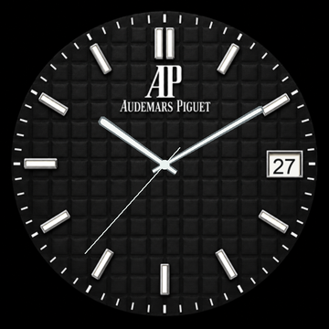

# AP Black — Garmin Forerunner 265S

A free, custom AP-inspired watch face with a black textured dial, prominent AP monogram, silver hour markers, moving hands, and a live date. Built for the Garmin Forerunner 265S and its 360 × 360 AMOLED screen.

## Install

1. Download [APBlack-fr265s.prg](downloads/APBlack-fr265s.prg). On GitHub, open the file and use the download button.
2. Connect your **Forerunner 265S** to your computer using a USB data cable.
3. Copy the file to `GARMIN/Apps` on the watch. On macOS, the watch uses MTP, so a file-transfer tool such as [OpenMTP](https://openmtp.ganeshrvel.com/) may be needed.
4. Disconnect the watch, hold **UP**, choose **Watch Face**, select **AP Black**, and apply it.

This build targets the **265S** specifically. It has not been built or tested for the larger 265 or other Garmin models.

## What it does

- Displays the watch’s local time and date; the seconds hand appears in the active view.
- Uses a simplified always-on view with thin hands and a date, shifted periodically.
- Requires no subscription, phone connection, GPS, or health permissions.

The project compiled with Garmin Connect IQ SDK 9.3.0 and was exercised in the 265S simulator. The file was transferred to a 265S; extended battery and burn-in behaviour have not been measured.

## Build your own

Install the [Garmin Connect IQ SDK Manager](https://developer.garmin.com/connect-iq/sdk/), download the SDK and the Forerunner 265S device profile, and install Java 11 or newer. On macOS, run `./Build.command` from this directory. It generates a local signing key if needed and writes `bin/APBlack-fr265s.prg`. Keep the key private and retain it for future updates.

Source lives in `source/`, and watch resources live in `resources/`. Run `tools/make_assets.py` with Python and Pillow to regenerate the date wheels and preview; it uses macOS system fonts. Artwork creation details are in [ASSET-PROMPT.md](ASSET-PROMPT.md).

This is a personal custom watch face and is not an official Audemars Piguet or Garmin product.
